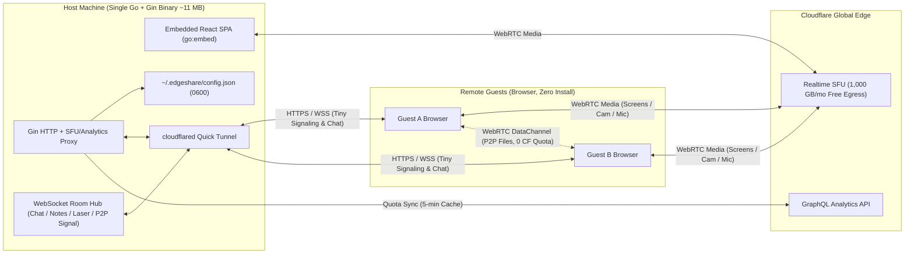

# EdgeShare ⚡

> **Zero-VPS, Single-Binary Screen Sharing & Meetings — Powered by Your Own Cloudflare Realtime 1,000 GB/mo Free Tier!**

[](https://go.dev/)
[](https://react.dev/)
[](https://developers.cloudflare.com/realtime/)
[](LICENSE)

---

## ⚡ Why EdgeShare? — Zero Server Bills, Full Control

> [!IMPORTANT]
> **Keep Your Keys Local & Use Cloudflare's 1,000 GB/mo Free Egress!**  
> Cloudflare Realtime SFU & TURN include **1,000 GB of free egress every month** (and **100% free ingress**).  
> Instead of renting a VPS, configuring Nginx/SSL, or deploying complex Cloudflare Workers, **EdgeShare** compiles into a **single ~11 MB Go binary** with the React frontend embedded inside:
> - **Host runs one binary locally**: Your `App Secret` and `Analytics Token` stay locked in `~/.edgeshare/config.json` (`0600`) — guests never see them.
> - **Instant HTTPS Public Link**: Built-in `cloudflared` Quick Tunnel generates a `https://*.trycloudflare.com` link in seconds so remote guests join directly in their browser with **zero installs**.
> - **Live Quota Guard & Circuit Breaker**: Tracks real-time session Mbps (`getStats()`) alongside Cloudflare's GraphQL Analytics API and automatically blocks new streams before hitting paid overages.

---

## ✨ Features

| Category | Capabilities |
| :--- | :--- |
| **🖥️ Multi-Screen Sharing** | Simultaneous multi-person screen sharing with **Focus View** & **Multi-Grid (up to 2×2)**, system audio capture, and 3 quality presets: **Eco (720p 15fps)**, **Standard (1080p 30fps)**, **Ultra (60Hz / 10 Mbps)**. |
| **📹 Cameras & Voice** | Adaptive **Camera Filmstrip** (shrinks under screen shares, expands to a responsive grid when idle), 360p/450kbps quota-friendly video, **Eco Mode** (hide remote cameras), VAD speaking glow, `Space` Push-to-Talk, and `Ctrl/Cmd + M` mute. |
| **🎯 Laser & Annotations** | Real-time **Laser Pointer** & **Pen Strokes** synced across all viewers over WebSocket with smooth ~3.8s fade-out. |
| **📂 P2P File Transfer** | Drag-and-drop or pick files in chat to send via **WebRTC `DataChannel`** directly between peers — **0 GB Cloudflare quota consumed**. |
| **🔴 Local Recording** | One-click browser `MediaRecorder` mixes the active screen video + all meeting audio into a local `.webm` file with zero server CPU load. |
| **📝 Chat & Shared Notes** | Rich chat with `Ctrl/Cmd + V` screenshot paste, auto-linked URLs, code blocks, plus a real-time **Shared Markdown Notes** tab with `.md` export. |
| **🛡️ Host Controls** | Room password, **Max Participants** cap, **Waiting Room** approval, Lock Room, Mute All, Kick, and **Cloudflare Quota Circuit Breaker**. |
| **🌍 UI & Polish** | **5 Languages** (`English` default, `简体中文`, `日本語`, `Español`, `Français`), **Dark / Light Theme**, Framer Motion spring animations, WebSocket auto-reconnect, and Mic/Cam/Speaker device switcher. |

---

## 🏗️ Architecture

**Signaling & Secrets** stay on the Host's lightweight Go/Gin binary (exposed via `cloudflared` HTTPS tunnel when remote), while **Heavy Media Streams** flow directly between browsers and Cloudflare's global edge SFU:



---

## 🚀 Quick Start

### 1. Prerequisites
- **Go 1.22+** and **Node.js 20+**
- A free [Cloudflare Account](https://dash.cloudflare.com/)

### 2. Get Your Cloudflare Credentials
1. **SFU App (Required)**: Open **Cloudflare Dashboard → Realtime → SFU → Create Application**, then copy **`App ID`** and **`App Secret`**.
2. **Quota Monitor (Optional)**: Copy your **`Account ID`**, then go to **My Profile → API Tokens → Create Custom Token** with permission `Account → Account Analytics → Read`.

### 3. Build & Run
```bash
git clone https://github.com/Chillwinner/EdgeShare.git
cd EdgeShare

# 1. Build embedded React frontend
cd web && npm install && npm run build && cd ..

# 2. Build single Go binary
go build -o edgeshare .

# 3. Launch (auto-opens Host Console in your browser)
./edgeshare
```

> [!TIP]
> Inside the Host Console, click **Settings** to paste your `App ID` / `App Secret` and click **One-Click Install** to download `cloudflared` automatically. Your config is saved locally at `~/.edgeshare/config.json`.

---

## ⚙️ Configuration Reference

See [`config.example.json`](config.example.json) for a sample configuration file. You can configure everything from the Web UI or via environment variables:

| Field / Env Var | Default | Description |
| :--- | :--- | :--- |
| `appId` / `CF_APP_ID` | — | Cloudflare Realtime SFU App ID |
| `appSecret` / `CF_APP_SECRET` | — | Cloudflare Realtime SFU App Secret (never exposed to guests) |
| `accountId` / `CF_ACCOUNT_ID` | — | Optional Cloudflare Account ID for GraphQL quota tracking |
| `analyticsToken` / `CF_ANALYTICS_TOKEN` | — | Optional read-only `Account Analytics: Read` API token |
| `quotaWarnGb` | `850` | Yellow warning threshold (disables 10 Mbps Ultra preset) |
| `quotaLimitGb` | `950` | Hard circuit-breaker limit (blocks new SFU sessions) |
| `port` | `8787` | Local HTTP/WebSocket listen port |

---

## 📁 Project Structure

```text
EdgeShare/
├── main.go                     # Gin server, host auth middleware, go:embed SPA
├── config.example.json         # Sample configuration template (no secrets)
├── internal/
│   ├── config/config.go        # Local ~/.edgeshare/config.json persistence
│   ├── cloudflare/
│   │   ├── sfu.go              # Cloudflare Realtime SFU API proxy & circuit breaker
│   │   └── analytics.go        # GraphQL Analytics API client (5-min cache)
│   ├── tunnel/tunnel.go        # cloudflared Quick Tunnel & auto-installer
│   └── room/hub.go             # WebSocket rooms, waiting room, chat, notes, P2P relay
└── web/                        # React 19 + TypeScript + Tailwind v4 + Framer Motion
    └── src/
        ├── i18n.tsx            # 5-language dictionary (EN default, ZH, JA, ES, FR)
        ├── theme.tsx           # Dark / Light theme provider & switcher
        ├── hooks/              # useWebRTC, useP2PTransfer, useRecorder, useVAD
        └── components/         # LobbyView, StageArea, TopQuotaBar, ChatDrawer, Modals
```

---

## 📄 License

MIT License
